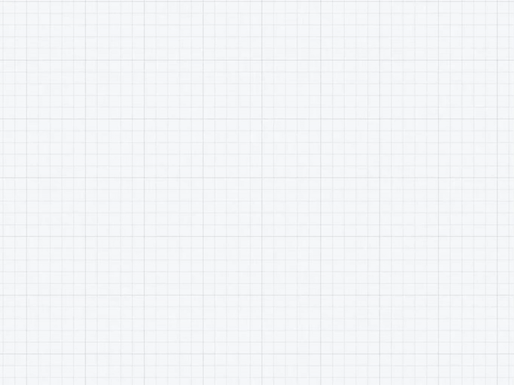

<h1 align="center">Weave</h1>

<a href="README.en.md">English</a> · 中文

纯网页的节点式图编辑器 —— 自由摆放节点，拖拽 socket 连线，构建思维导图、流程图与逻辑树。

<h2>立刻开始</h2>

  

1. **在线使用** — 打开 [quan-chan.github.io/Weave](https://quan-chan.github.io/Weave/) 直接使用，无需下载
2. **下载** — 下载 `APPs/Weave.html`（完整版）或 `APPs/Weave.min.html`（压缩版，功能一致），不需要安装
3. **打开** — 用任意现代浏览器（Chrome / Edge / Firefox / Safari）打开文件
4. **使用** — 双击画布生成节点，拖拽 socket 连接节点，双击文字即改即得

<h2>功能</h2>

- **画布模式** — 顶栏最右的模式按钮在**节点图**与**时序图**之间切换；两个模式各持一份独立文档，切换即保存上一模式的内容
- **节点** — 添加、删除、选中（单击 / 框选 / 多选模式 / Ctrl+单击）、拖拽移动、内联编辑、复制粘贴、右键调整节点大小（无级拖动，松手平滑吸附到网格）
- **连线** — socket 拖拽创建、删除、标签编辑、贝塞尔曲线自定义调整
- **时序图** — 节点连接点位于底边中点，向下引出时序线；拖拽末端把手改长度；在时序线上拖出水平消息箭头指向另一节点的时序线，拖动时可上下移动决定高度；消息右键「调整位置」或改线型（实线 / 虚线），连接点右键「调整位置」可带动其上所有消息；消息被拖出时序线范围时先变红色虚线预告断裂（松手后该消息才被移除）
- **画框分区** — Region 键 / Alt+左键拖拽创建；整体移动（联动框内节点）、调整大小；右键编辑名称颜色、删除；节点拖入自动归属；分区可嵌套
- **高度对齐** — 时序图模式的侧边栏工具：开启后在画布上按下并拖到目标高度，松手把全部节点（已选中时只拉选中的）拉到该高度
- **节点串收起** — 点击节点右侧输出连接点的 − 徽标收起其后相连的节点串，+ 徽标展开；支持嵌套
- **关联高亮** — 按住 Alt 单击节点，高亮直接关联的节点与连线，其余内容加轻微模糊
- **画布** — 平移（拖拽 / 中键）、滚轮缩放、适应视图、坐标 HUD 编辑
- **颜色** — 5 种预设色 + 自定义色轮选择器，Ctrl+滚轮快速切换
- **导入/导出** — JSON 导入导出（含视口信息）、PNG 导出（图片内嵌存档 JSON，可拖回导入）、拖拽 JSON/PNG 文件导入
- **其他** — 撤销/重做（最多 50 步）、只读模式、专注模式（Ctrl+H）、键位设置（首次启动自动弹出，快捷键可自定义）、对齐设置（节点位置与大小、分区位置与大小、连线高度对齐网格，可一键重置；设置界面按当前画布模式显示对应的一套）、语言切换（设置内：中文 / English）、自动保存到 localStorage
- **触控** — 单指拖拽空白平移、单指拖拽节点/连接点/调整手柄、双指捏合缩放并平移、点按选中、双击生成节点与编辑文字、长按弹上下文菜单（节点/连线/分区/空白）、侧边栏「框选」模式替代 Shift+拖拽、窄屏响应式布局

<h2>技术栈展示</h2>

Weave 用纯前端技术构建，零框架、零依赖、零构建步骤，一个 HTML 文件就是完整产品：

- **纯 JavaScript** — 全部逻辑内联在单文件中，无框架、无构建，源码即产品
- **HTML5 + CSS3** — 原生标签结构 + CSS 变量主题，界面风格统一易维护
- **Canvas 2D** — 在屏幕像素空间绘制网格背景
- **SVG** — 承载连线、分区、贝塞尔控制手柄与标签，可精确交互
- **localStorage** — 画布数据自动持久化，刷新或重开不丢失

<h2>性能测试数据</h2>

仓库附带压测与演示存档（位于 `test/samples/`），在 Weave 中通过「导入」加载（JSON 导入按钮，或直接把文件拖进画布）：

- **`test/samples/weave_250_nodes.json`** — 250 个节点、465 条连线的常规图
- **`test/samples/weave_arrow_demo.json`** — 6 个节点、4 条连线的箭头形状演示

250 个节点、62250 条连线的全连接图体积较大，不入库。双击 `test/samples/gen-fullmesh.cmd`（或在 `test/samples/` 执行 `node gen-fullmesh.js`）生成 `weave_250_fullmesh.json`，再用「导入」加载。

<h2>恢复工具</h2>

软件因异常数据加载导致无法正常启动时，可以关闭全部 Weave 页面，打开恢复页进行修复操作：

| 使用场景 | 恢复页地址 |
| --- | --- |
| 本地下载版 | 双击 [`APPs/Weave-recovery.html`](APPs/Weave-recovery.html) |
| 在线版 | <https://quan-chan.github.io/Weave/recovery.html> |

恢复页显示已保存数据的字符数，按千进制换算为 B、KB、MB，并提供以下操作：

- 清空全部节点、连线和分区，保留软件设置；
- 导入或导出节点图 JSON；
- 修改对齐、语言、新节点颜色、新建自动打开详情、界面隐藏和首次启动弹窗（界面语言与主程序共用同一个开关）；
- 编辑撤销、重做、全选、复制、粘贴等 10 项键位；重置键位；清除自选颜色；重置全部设置。

恢复页顶部会声明当前查看的是哪一份数据。浏览器按来源隔离存储，本地版与在线版各存一份，一个页面无法读写另一份。

Weave 页面关闭时可能写入内存中的节点图数据。执行清空、导入或键位修改前需要关闭全部 Weave 页面。键位修改在重新打开 Weave 后生效。

<h2>许可证</h2>

本项目采用 <a href="LICENSE">Apache License 2.0</a> 开源。

<pre>Copyright © 2026 Quan-Chan</pre>
